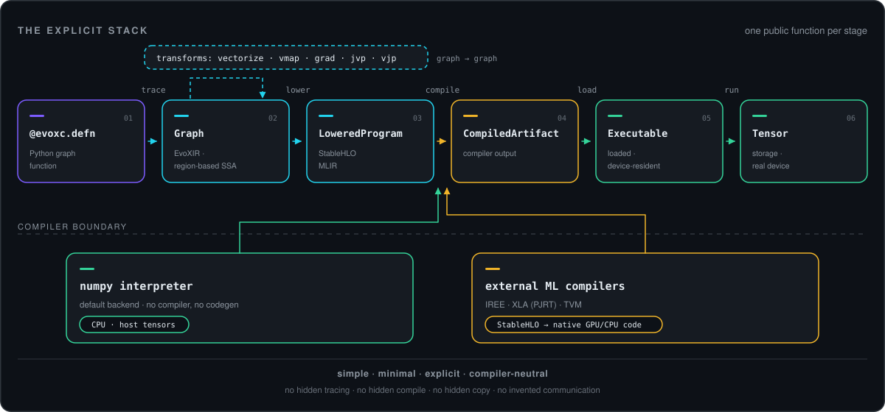

<div align="center">


<h1 align="center">evoxc</h1>

<p><strong>EvoX Compiler</strong> — a minimal, explicit, compiler-neutral tensor graph compiler and runtime.</p>

<p>
  <a href="#install"></a>
  <a href="#install"></a>
  <a href="#backends"></a>
  <a href="#status--deferrals"></a>
  <a href="#license"></a>
</p>

<p><a href="https://github.com/EMI-Group/evox">EvoX</a> · <a href="#why-evoxc-exists">Why</a> · <a href="#the-stack-from-a-python-graph-to-an-ml-compiler">The stack</a> · <a href="#quickstart--sixty-seconds">Quickstart</a> · <a href="#features">Features</a> · <a href="#batch-transformation--one-graph-for-a-whole-population">Batch</a> · <a href="#backends">Backends</a> · <a href="#hardware-support">Hardware</a> · <a href="#how-evoxc-compares">Compared</a> · <a href="#install">Install</a></p>
</div>

**evoxc (EvoX Compiler)** is a Python tensor graph compiler and runtime for building, transforming, and executing numerical programs. It provides explicit computation graphs, composable vectorization and automatic differentiation, and StableHLO integration with IREE, XLA, and TVM. A NumPy interpreter lets you get started without a compiler toolchain.

Part of the [EvoX ecosystem](https://github.com/EMI-Group/evox), evoxc provides the compilation and execution foundation for the experimental [EvoX 2.0 alpha](https://github.com/EMI-Group/evox/tree/evoxc-exp). Its graph transformations support population-based workloads, including batched evaluation and combining multiple candidate programs into a single graph. evoxc can also be used independently for numerical computing.

evoxc owns graph construction, transformations, and the explicit trace → lower → compile → load → run pipeline. External compilers handle optimization and code generation. EvoX 1.x continues to use PyTorch; the evoxc-based integration is developed in the experimental 2.0 line.

---

## Why evoxc exists

Evolutionary computation repeatedly evaluates populations of candidates and updates their state. These workloads benefit from batching evaluations and reusing an executable across iterations, with state kept on the execution device. When the candidates are programs, as in genetic programming and algorithm synthesis, evaluating them separately can also repeat compilation and dispatch work.

evoxc makes these computations explicit tensor graphs that you can inspect, transform, save, and execute. `vmap` batches a computation over inputs, while [`batch_functions`](#batch-transformation--one-graph-for-a-whole-population) combines compatible candidate programs into a single graph. The explicit pipeline lets an application build an executable once and reuse it throughout a search loop.

The **frontend** owns the tensor-graph language, EvoXIR, graph transformations, and the staging contract — every stage is a public function with a public result object. **External compilers** — IREE, XLA via PJRT, and TVM — receive StableHLO and handle optimization, scheduling, memory planning, and code generation. This separation lets applications choose a backend while keeping the graph's meaning explicit.

## Four words

**Minimal** — pure Python with NumPy as the only required dependency. The built-in interpreter runs graphs without a compiler toolchain.

**Explicit** — each pipeline stage is a public function with a distinct result type. Inspect, save, or transfer intermediate objects at any stage.

**Compiler-neutral** — EvoXIR represents the program; StableHLO connects it to IREE, XLA, and TVM. Select an available backend with `backend=`.

**Simple** — convenience APIs compose the pipeline: `vmap` uses `vectorize`, `bind` passes arguments, and `build` combines `trace → lower → compile → load`.

## The stack: from a Python graph to an ML compiler



| stage | public function | resulting object | what it produces |
|---|---|---|---|
| graph function | `@evoxc.defn` | `Defn` | a Python callable marked as a graph *definition* |
| trace | `evoxc.trace(fn, *specs)` | `Graph` | EvoXIR: a region-based SSA module + input/output trees + snapshotted static values |
| transform | `evoxc.vectorize` / `vmap` / `batch_functions` / `grad` / `jvp` / `vjp` | `Graph` | an ordinary graph of ordinary ops |
| lower | `evoxc.lower(graph, backend=…)` | `LoweredProgram` | StableHLO MLIR text, or the backend's own payload |
| compile | `evoxc.compile(lowered, **opts)` | `CompiledArtifact` | the compiler's artifact (vmfb, PJRT executable, serialized program) |
| load | `evoxc.load(artifact, device=…)` | `Executable` | a device-bound executable that can be called |
| run | `evoxc.run(exe, *args)` | `Tensor` (tree) | outputs in the same pytree shape you passed in |

The default **NumPy interpreter** executes EvoXIR with NumPy kernels. Compiler backends receive StableHLO: **IREE** targets llvm-cpu, CUDA, ROCm, and Vulkan-SPIRV; **XLA** uses a PJRT plugin; **TVM** uses its StableHLO frontend and Relax VM.

See [CONTEXT.md](CONTEXT.md#architecture-overview) for module dependencies and architecture details.

## Quickstart — sixty seconds

Each pipeline stage returns an object you can inspect and reuse:

```python
import evoxc
from evoxc import TensorSpec

@evoxc.defn
def f(x, w):
    return evoxc.sum(evoxc.tanh(evoxc.dot(x, w)), axes=1)

spec_x, spec_w = TensorSpec((4, 8), evoxc.float32), TensorSpec((8, 4), evoxc.float32)
graph    = evoxc.trace(f, spec_x, spec_w)                       # Graph          (EvoXIR)
lowered  = evoxc.lower(graph)                                   # LoweredProgram
artifact = evoxc.compile(lowered)                               # CompiledArtifact
exe      = evoxc.load(artifact, device="cpu")                   # Executable
y        = evoxc.run(exe, evoxc.ones((4, 8)), evoxc.ones((8, 4)))   # Tensor
print(y.numpy())     # [3.999999 3.999999 3.999999 3.999999]
print(graph)         # <Graph 2 tensor inputs, 0 static values>
```

Use `build` or `evaluate` for the same pipeline in one call:

```python
exe = evoxc.build(f, spec_x, spec_w, device="cpu")          # trace → lower → compile → load
y   = evoxc.evaluate(f, evoxc.ones((4, 8)), evoxc.ones((8, 4))) # derive specs → build → run
```

Run the same graph with a compiler backend (`pip install evoxc[iree]`, or `evoxc[tvm]`, or `pip install jax-rocm7-pjrt` / `jax-cuda12-pjrt` for `xla`):

```python
exe = evoxc.build(f, spec_x, spec_w, backend="iree", device=evoxc.Device("cuda", 0),
                target_backends=["cuda"], opt_level="O3")
y   = evoxc.run(exe, evoxc.ones((4, 8)).to(exe.device), evoxc.ones((8, 4)).to(exe.device))
```

**Graph transforms compose.** Combine `vmap` and `grad` to compute batched per-sample gradients:

```python
@evoxc.defn
def loss(x, y, w):
    d = evoxc.subtract(evoxc.tanh(evoxc.dot(x, w)), y)
    return evoxc.mean(evoxc.multiply(d, d))          # one scalar per sample

per_sample_grad = evoxc.vmap(evoxc.grad(loss, argnums=(2,)), in_axes=(0, 0, None), out_axes=(0,))
specs = (TensorSpec((8, 4, 8), evoxc.float32), TensorSpec((8, 4, 4), evoxc.float32),
         TensorSpec((8, 4), evoxc.float32))        # 8 samples of [4, 8]; the weights are shared
graph = per_sample_grad(*specs)                  # Graph — nothing has run yet
exe   = evoxc.load(evoxc.compile(evoxc.lower(graph)), device="cpu")
dw,   = evoxc.run(exe, evoxc.ones((8, 4, 8)), evoxc.zeros((8, 4, 4)), evoxc.ones((8, 4)))
print(dw.shape, dw.dtype, dw.device)             # (8, 8, 4) float32 Device(kind='cpu', index=0)
```

**Device-resident iteration.** A non-cpu executable rejects host inputs at the run boundary, so the loop *is* the pattern: place state once, then feed each run's device outputs back as the next run's inputs — zero host round-trips, zero implicit staging. At DE scale (4096×50, ~8 IREE dispatches per step) this costs ~0.15–0.5 ms/step, against ~1.05–2.8 ms when re-staging the ~800 KB state each step.

```python
device = evoxc.Device("cuda", 0)
exe = evoxc.build(step, *specs, backend="iree", device=device,   # step: @evoxc.defn
                target_backends=["cuda"], opt_level="O3")       # (key, state) -> (state, key)
state, key = evoxc.tensor(state0).to(device), evoxc.tensor(seed).to(device)  # upload once
for _ in range(steps):
    state, key = evoxc.run(exe, key, state)     # inputs and outputs stay on `device`
host = state.to(evoxc.Device("cpu", 0)).numpy() # the only way back
```

## The value model

Python values specialize a graph, symbolic values describe its computation, and `Tensor` holds runtime data:

| concept | meaning | has storage? | guarantees |
|---|---|---|---|
| Python/static value | `None`, bool, int, float, str, `Enum`, dtype, `slice`, config objects | n/a | evaluated at trace time and snapshotted into the graph; changing a static value requires tracing a new graph |
| `TensorSpec` | describes a future runtime tensor: `shape` (symbolic dims allowed), `dtype`, optional `device` | no | the only thing you can pass as a trace input besides static values |
| `SymbolicTensor` | an SSA value inside a graph | **no** | `dtype`, symbolic shape, source location, SSA identity |
| `Tensor` | a materialized runtime tensor | yes | concrete shape/dtype and a **physical** `device`: numpy host data is `Device('cpu', 0)`, a device payload reports its real device |

Pass runtime tensors as graph inputs. Capturing a `Tensor` in a closure raises `TraceError`; use `evoxc.constant` to embed host data explicitly (this emits a warning).

## Features

<a id="explicit-graph-construction--and-no-eager-mode"></a>

### Explicit graph construction

`@evoxc.defn` defines a graph. Use `evoxc.trace` to construct it or `evoxc.evaluate` to execute it; calling the definition directly with a `Tensor` raises `TraceError`. A traced `Graph` can be printed, verified, saved, transformed, and lowered:

```python
graph = evoxc.trace(f, spec_x, spec_w)
graph.print()                  # the EvoXIR module, one op per line
graph.verify()                 # explicit IR verification
graph.save("f.evoxcgraph")       # portable, versioned JSON container
```

```
module @"main" version 1 {
  func @main(%arg0: tensor<4x8xf32>, %arg1: tensor<8x4xf32>) -> tensor<4xf32> {
    %0 = evoxc.dot(%arg0, %arg1) : tensor<4x4xf32> loc("f.py":6:0)
    %1 = evoxc.tanh(%0) : tensor<4x4xf32> loc("f.py":6:0)
    %2 = evoxc.reduce_sum(%1) attributes {axes = [1], keepdims = False, reduce_op = "sum"} : tensor<4xf32>
    evoxc.return(%2)
  }
}
```

### Graph → graph transforms

`evoxc.vectorize`, `vmap`, `grad`, `jvp`, `vjp`, and `batch_functions` transform graphs into ordinary operations that backends can execute. Given a function or `Defn`, they return a callable that builds a graph from specs. Missing batching or derivative rules raise `TransformError` naming the operation.

```python
@evoxc.defn
def scalar_loss(x, y, w):
    d = evoxc.subtract(evoxc.dot(x, w), y)
    return evoxc.mean(evoxc.multiply(d, d))

g  = evoxc.trace(scalar_loss, *specs)
gb = evoxc.vmap(g, in_axes=(0, 0, None))    # batch the samples, share the weights
gw = evoxc.grad(g, argnums=(2,))            # d/dw — still just a Graph
```

### Batch transformation — one graph for a whole population

An outer loop that writes a *different static program* every iteration — neural-architecture search, genetic programming, algorithm synthesis — normally pays a trace, a compile and a dispatch per candidate. `evoxc.batch_functions` evaluates the whole population as **one** ordinary graph:

```
evoxc.batch_functions(fns, axes=0, out_axes=0, *, switch_ops=None, bands=None, alignment="variant")
```

`fns` is a non-empty list of programs that share their input AND output specs: traced `Graph`s, or callables/`Defn`s — use one representation consistently. The result is a single `Graph` whose leading axis is a **static**, length-N *function axis*: row `i` evaluates program `i`, a mapped input (`axes=0`) supplies its own row, and an unmapped one (`axes=None`) is shared by every program.

Programs are aligned by an occurrence-indexed structural skeleton signature. A position where every program has the same op collapses into **one** batched op, rebuilt through the same per-op batching rules `vmap` uses — identical programs emit zero `select`s. A same-skeleton position whose op differs merges into one switch class once `switch_ops` opts in (`True` = the `elementwise` + `comparison` categories; an explicit list names categories or op-name sets), emitting one op per variant plus a static per-row `select` cascade. All remaining divergence is `select`-muxed at the consumers and the outputs, so **any** same-signature program list merges correctly, and per-program constants stack into one `(N, …)` constant.

```python
progs  = [evoxc.trace(program(i), spec_x, spec_c) for i in range(32)]   # same signature, different bodies
specs  = (TensorSpec((32, 64), evoxc.float32), TensorSpec((1,), evoxc.float32))

merged = evoxc.batch_functions(progs, axes=(0, None), switch_ops=True)  # ONE Graph, a 32-wide function axis
exe    = evoxc.load(evoxc.compile(evoxc.lower(merged)), device="cpu")   # an ordinary executable
y      = evoxc.run(exe, stacked_params, c)      # y[i] is program(i)'s own output, bit for bit
print(merged.batch_report.value_classes)        # the merge itself, as data
```

Two keyword-only knobs tune the merge, and neither can change a row's value:

- **`bands`** — `None` (the default) merges all N programs on one flat function axis; an `int K` merges K contiguous bands independently and concatenates their outputs, so a class that only one band needs is computed over that band's rows; `"auto"` groups programs by structural fingerprint and lets a static work-vs-dispatch cost model pick a partition (never worse than flat by its own estimate).
- **`alignment`** — `"variant"` (the default) sends a program's switched op into an existing class that already holds that variant, which collapses sibling branches such as `(x+c)*(x-c)` written in a different order per program; `"occurrence"` is the byte-stable legacy merge; `"auto"` is variant-first with an occurrence fallback.

The recipe follows the hardware: **CPU → `bands="auto"`; GPU → `bands=16` or `bands=None`**, because on a GPU dispatch is cheap and the flat (or a fixed-band) merge wins where `"auto"`'s CPU-calibrated dispatch constant misjudges.

32 programs of a 10-deep elementwise chain over a shared length-64 vector: **544 program ops collapse into 133 merged ops**, bit-identical to running the 32 programs separately, **2.8× faster per evaluation on numpy** (0.78 vs 2.18 ms) and **2.1× on `iree`/llvm-cpu** (0.63 vs 1.31 ms) — and **one merged IREE compile (0.45 s) replaces 32 (6.7 s, 15×)**. At N=100 unrelated expression trees over two `(64,)` inputs, separate → flat → banded is 5.4 → 3.32 → **2.24 ms** on numpy, and 4.7 → 18.73 → **0.386 ms** on `iree`/llvm-cpu: flat is 4× *worse* than not merging there, and banding recovers 12×.

Inspect the merge through `graph.batch_report`: it records value classes, shared and switched operations, output muxes, emitted operations, band sizes, and cost estimates. This transform metadata is available in memory and is not saved with the graph. See [current limitations](#status--deferrals) for unsupported batching rules.

### In-graph control flow

`evoxc.cond`, `evoxc.while_loop` and `evoxc.scan` trace their branch and body functions into IR regions, so control flow is part of the persisted program.

```python
@evoxc.defn
def sqrt_newton(x):
    def cond_fn(s):
        y, prev = s
        return evoxc.greater(evoxc.abs(evoxc.subtract(y, prev)), 1e-6)
    def body_fn(s):
        y, prev = s
        return 0.5 * (y + x / y), y
    y, _prev = evoxc.while_loop(cond_fn, body_fn, (x, evoxc.constant(evoxc.zeros((), evoxc.float32))))
    return y

exe = evoxc.build(sqrt_newton, TensorSpec((), evoxc.float32), device="cpu")
print(evoxc.run(exe, evoxc.tensor(2.0)).numpy())     # 1.4142135
```

A Python `if`/`while` on a symbolic value raises `TraceError: SymbolicTensor cannot be used as a Python boolean … runtime tensor control flow must use evoxc.cond`.

### Symbolic shapes and pytree I/O

A `Dim` is a named symbolic extent (`DimExpr` supports `+ - * // % min max` over dims and ints). Inputs and outputs are arbitrary pytrees, flattened once per call and validated structurally with first-mismatch-path errors; per-call host cost is leaf-driven, not graph-driven (~2–3.5 µs per tensor leaf, ~0 per op).

```python
B = evoxc.dim("B")

@evoxc.defn
def model(params, batch):
    h = evoxc.tanh(evoxc.dot(batch["x"], params["w1"]) + params["b1"])
    return {"logits": evoxc.dot(h, params["w2"]), "hidden": h}

spec = ({"w1": TensorSpec((4, 8), evoxc.float32), "b1": TensorSpec((8,), evoxc.float32),
         "w2": TensorSpec((8, 3), evoxc.float32)},
        {"x": TensorSpec((B, 4), evoxc.float32)})      # symbolic batch
exe = evoxc.build(model, *spec, device="cpu")          # one executable, any batch size
out = evoxc.run(exe, {"w1": evoxc.ones((4, 8)), "b1": evoxc.zeros((8,)), "w2": evoxc.ones((8, 3))},
              {"x": evoxc.ones((5, 4))})               # {'hidden': (5, 8), 'logits': (5, 3)}
```

### Explicit collectives and physical placement

Declare communication with `evoxc.dist.*` operations in the graph. `split_tensor` and `replicate_tensor` prepare data in host memory; use `Tensor.to(device)` to transfer it. See [hardware support](#hardware-support) for device placement and [current limitations](#status--deferrals) for compiled collectives.

```python
@evoxc.defn
def distributed_step(x):
    grp = evoxc.dist.group("world", [0, 1])
    return evoxc.dist.all_reduce(x, group=grp, op="sum")

evoxc.trace(distributed_step, TensorSpec((4,), evoxc.float32)).print()
#   %0 = evoxc.all_reduce(%arg0) attributes {group = "world", group_size = 2, reduce_op = "sum"}
```

### Sparse tensors

`evoxc.sparse` is a first-class value model — `SparseTensor`/`CSRTensor`/`CSCTensor` for data, `SparseTensorSpec` at trace time, symbolic instances inside graphs — with 16 graph ops (COO/CSR/CSC conversion, union `add`, intersection `multiply`, `multiply_dense`, `reduce_sum`, `transpose`, `reshape`, `concatenate`, sparse@dense and dense@sparse `matmul`) and numpy kernels that validate structure at runtime. Batching and derivative rules travel with the ops, so sparse values flow through `vmap`/`grad` and through `cond`/`while_loop`/`scan`. Compiler backends defer sparse with an explicit `BackendError` suggesting `evoxc.sparse.to_dense`.

```python
s = evoxc.sparse.coo(np.array([[0, 0], [1, 2]]), np.array([1.5, 2.5], np.float32), (3, 4))

@evoxc.defn
def sparse_step(s):
    return evoxc.sparse.to_dense(evoxc.sparse.multiply(s, s))

exe = evoxc.build(sparse_step, evoxc.sparse.SparseTensorSpec.from_concrete(s), device="cpu")
print(evoxc.run(exe, s).numpy())          # [[2.25 0 0 0] [0 0 6.25 0] [0 0 0 0]]
```

### Key-based functional RNG

`evoxc.random` is stateless and deterministic: a key is a value, ops never consume it, and the same key with the same operands yields bit-identical numbers across processes. The algorithm *is* the key's static shape/dtype — `splitmix64` (rank-0 i64, default), `threefry2x32` (`(2,)` i32), `philox4x32_10` (`(4,)` i32). The default was chosen by measurement: splitmix64 is fastest on both CPU paths and ties on GPU, winning every ≥4M-element cuda cell; threefry2x32 wins the small-sample GPU cells and is one `algorithm=` argument away.

```python
@evoxc.defn
def sample(key):
    k1, k2 = evoxc.random.split(key)
    return evoxc.random.normal(k1, (3, 2)), evoxc.random.randint(k2, (3,), 0, 10)

exe = evoxc.build(sample, TensorSpec((), evoxc.int64), device="cpu")
a, b = evoxc.run(exe, evoxc.random.key(42))     # same key, same bits — in any process
```

### Custom kernels

When a kernel must stay opaque — Triton, hand-written CUDA, anything you cannot express as a graph — declare the call inside the graph and register the implementation out of band. Kernels resolve per backend (exact slot → default slot), may be **device-resident** (device tensors in and out, zero host round-trips) and may declare batched variants:

```python
@evoxc.defn
def model(x, w):
    h = evoxc.external_call("triton_add", x, result=evoxc.TensorSpec((4, 8), evoxc.float32))
    return evoxc.dot(h, w)                    # downstream ops consume it like any SSA value

handle = evoxc.register_external_kernel("triton_add", _no_cpu_fallback)  # default slot
handle.batch_variant(fused_add)                                        # batched kernel sugar

@handle.impl("iree")                        # per-backend slot: numpy in, numpy out
def triton_add_iree(x):
    ...
```

Register custom kernels in each process that loads the graph; saved graphs store their names. Backends without host dispatch use a registered portable decomposition (`@handle.portable` over `@evoxc.defn`) with a warning, or raise `BackendError`. Worked examples: [`tests/ops/test_external_call.py`](tests/ops/test_external_call.py) and [`tests/backends/test_external_call_iree.py`](tests/backends/test_external_call_iree.py).

### Custom ops

Not every custom op needs an external kernel. `evoxc.block` declares an op with specs, a portable decomposition written as an ordinary `@evoxc.defn` graph, optional per-backend implementations and optional batching/vjp rule registrations:

```python
l2norm = evoxc.block("l2norm", inputs=[TensorSpec((4, 8), evoxc.float32)],
                   outputs=[TensorSpec((4, 8), evoxc.float32)])

@l2norm.portable
@evoxc.defn
def _l2norm(x):
    return evoxc.divide(x, evoxc.sqrt(evoxc.sum(evoxc.square(x), axes=-1, keepdims=True)))

@l2norm.impl("numpy")                                     # optional fast path
def _l2norm_numpy(x):
    return x / np.sqrt(np.sum(x * x, axis=-1, keepdims=True))
```

The numpy backend keeps a registered impl as a `block_call` and dispatches it, and inlines the portable when a block has no numpy impl. Compiler adapters declare `custom_blocks=False` in v1 and reject a block graph with an explicit `BackendError`.

### Inspectable and persistable graphs

Every stage object round-trips: a `Graph` as `.evoxcgraph`, a StableHLO `LoweredProgram` as `.mlir` text, a `CompiledArtifact` as `.evoxcartifact`. Loading with a mismatched backend, device or ABI is a `PersistenceError`. `evoxc.persist.Cache`/`FileCache` are the explicit caching primitives, and `build_cached` + `CompileCache` memoize the whole `trace → lower → compile → load` composition for meta-level loops (NAS, genetic programming, algorithm synthesis) that emit a different static program per outer iteration:

```python
cache = evoxc.CompileCache(maxsize=64)             # in-memory LRU; keys computed BEFORE tracing
exe_a = evoxc.build_cached(f, spec_x, spec_w, cache=cache, device="cpu")
exe_b = evoxc.build_cached(f, spec_x, spec_w, cache=cache, device="cpu")
print(exe_a is exe_b, cache.hits, cache.misses)  # True 1 1
```

### Async host ↔ device copies

`evoxc.io` schedules the explicit `Tensor.to` transfers on one process-global FIFO worker and hands back handles: validation is synchronous, transfer errors surface verbatim at `wait`/`result`, timeouts never cancel a copy. (Needs a device-transfer provider, e.g. `evoxc[iree]` on cuda/rocm.)

```python
copy = evoxc.io.prefetch(host_tensor, evoxc.Device("cuda", 0))   # -> AsyncCopy
copy.direction                                    # "host_to_device"
t = copy.result()                                 # wait + the device Tensor
out = evoxc.io.sink(device_tensor)                  # -> AsyncCopy, "device_to_host"
evoxc.io.wait_all()
```

### A conformance and benchmark harness

`evoxc.bench` ships 98 curated example programs — operation-level, small-block and end-to-end — stages every one through the explicit pipeline, and compares against pure-numpy references (plus PyTorch when installed) while reporting precision and speed.

```bash
python -m evoxc.bench                              # 98 examples, numpy/cpu conformance in ~10 s
python -m evoxc.bench --examples matmul,attention  # filter by name, category, or tag
```

Committed results, raw records and the probe scripts live in [`evoxc/bench/`](evoxc/bench); the wider campaign records and generated reports are archived in the separate `evoxc-bench` repository.

## Backends

| backend | how to enable | what it owns | validated on |
|---|---|---|---|
| **numpy interpreter** | nothing — the default | interprets EvoXIR directly with numpy kernels; all symbolic shapes | CPU (always) |
| **StableHLO export** | nothing — `evoxc.backends.stablehlo.export(graph)` | MLIR text emission; also the lowering input for every compiler | n/a (text) |
| **IREE** | `pip install evoxc[iree]`, `lower(..., backend="iree")` | IREE compile + HAL runtime, external-kernel host dispatch, device-resident payloads | llvm-cpu, CUDA, ROCm, Vulkan-SPIRV |
| **XLA** | `backend="xla"` — no path plumbing: it discovers an installed JAX plugin (`pip install jax-rocm7-pjrt` / `jax-cuda12-pjrt`), else `EVOXC_PJRT_PLUGIN` / `plugin_path` | PJRT C API via ctypes over an auto-discovered plugin `.so` — no `jax`/`jaxlib` | CUDA and ROCm (real plugins); CPU plumbing via a compiled test plugin |
| **TVM** | `pip install evoxc[tvm]`, `backend="tvm"` | StableHLO frontend + Relax VM (jaxlib only for its MLIR bindings) | CPU end-to-end; ROCm compile-only |

Set optimization with `opt_level` (`"O0"`–`"O3"`, `"0"`–`"3"`, or integers) or `EVOXC_OPT_LEVEL`. An explicit raw compiler flag takes precedence over the mapped option. Backend `Capabilities` describe supported features; unsupported operations raise `BackendError` with the operation name and a suggested remedy.

## Hardware support


Select the execution target with `backend=` and `device=`. Device kinds are `cpu`, `cuda`, `rocm` (alias `hip`), and `vulkan`; `evoxc.devices()` lists devices available on this host. Validated configurations are listed below.

- **NumPy interpreter** — CPU execution with symbolic-shape support, included in `pip install evoxc`.
- **IREE** — llvm-cpu, NVIDIA CUDA, AMD ROCm/HIP and Vulkan-SPIRV, all validated end-to-end (the Vulkan path on Mesa lavapipe, a software device). The `evoxc[iree]` pin is `iree-base` 3.13.0, on which the llvm-cpu and ROCm/HIP legs were re-validated device-resident — `while_loop`, `scan`, `while` nested in `cond` and the MO/NSGA2-class `non_dominate_rank` loop now compile and run with bit-exact integers, and the compile-crash class of 3.10/3.11 is gone (0 crashes in 30 compiles; records in [`evoxc/bench/iree313_rocm_findings.md`](evoxc/bench/iree313_rocm_findings.md)). CUDA was validated on the 3.11 release and is not re-exercised on 3.13 here (no NVIDIA GPU on the validating host). `pip install evoxc[iree]`.
- **XLA** — the PJRT C API driven directly over a plugin `.so` the adapter **discovers**: the `plugin_path` option, `EVOXC_PJRT_PLUGIN`, the fixed well-known paths, then an installed JAX plugin (`pip install jax-rocm7-pjrt` / `jax-cuda12-pjrt`; `jax-rocm7-pjrt==0.10.2` validated on ROCm with no env var and no path), so a pip-installed plugin needs no wiring — `EVOXC_PJRT_PLUGIN_DISCOVERY=0` opts out of that last step. The plugin's platform must physically serve the requested device kind, so accelerator use is `backend="xla", device="rocm"` (or `"cuda"`) with explicit placement, and a ROCm/CUDA plugin against `Device("cpu", 0)` is refused. CUDA and ROCm validated against real plugins, CPU plumbing validated with a compiled test plugin. No `jax`/`jaxlib`.
- **TVM** — CPU end-to-end; ROCm compile-only, because the wheel is built `USE_ROCM=OFF`. `pip install evoxc[tvm]`.

Move data with `Tensor.to(device)`. Inputs must match the executable's device; mismatches raise `DeviceError`. Outputs remain on that device. To read a GPU result as NumPy, call `.to(evoxc.Device("cpu", 0)).numpy()`. Execution preserves placement and dtype; supply casts, resharding, and communication explicitly.

## Built on evoxc: `evoxc_hf`

[`evoxc_hf`](evoxc_hf/CONTEXT.md) loads HuggingFace checkpoints and runs a model's forward pass as one evoxc graph. Models from GPT-2 (124M parameters) to Qwen3 (14B) use the same `trace → lower → compile → load → run` pipeline. Install it with `pip install evoxc-hf`.

The API has three steps: load configuration and weights with `load_config`, `load_params`, or `load_hf`; construct `(params, input_ids) -> logits` with `forward_fn`; then `build` and `run` the executable. Parameters are graph inputs. `build` uses `build_cached` to reuse compiled programs.

```python
import numpy as np
import evoxc, evoxc_hf

ckpt = "/path/to/checkpoint"                     # config.json + weights
loaded = evoxc_hf.load_hf(ckpt)                    # LoadedModel: .config, .params, .family, .model_dir
cfg, params = loaded.config, loaded.params

fwd = evoxc_hf.forward_fn(cfg, seq_len=32)         # (params, input_ids) -> logits; captures no weights
ids = np.zeros((1, 32), np.int32)                # static (batch, seq_len)

exe = evoxc_hf.build(fwd, cfg, backend="iree")     # numpy interpreter by default
logits = evoxc_hf.run(exe, params, ids)            # -> evoxc.Tensor on the executable's device
host = evoxc_hf.predict(loaded, ids, backend="iree")    # host-facing shorthand -> np.ndarray
oracle = evoxc_hf.reference_logits(cfg, params, ids)    # independent pure-numpy oracle
```

- **Families:** `llama` (also `mistral`/`qwen2`/`qwen3` — RMSNorm, RoPE, GQA, SwiGLU; Qwen3 adds per-head QK-Norm) and `gpt2` (also `distilgpt2` — LayerNorm, learned positions, `gelu_new`, tied head).
- **Parity** against real `torch`/`transformers` logits on eight checkpoints (`tiny_llama`, `tiny_mistral`, `tiny_gpt2`, `distilgpt2`, `gpt2`, `qwen3_0_6b`, `qwen3_1_7b`, `qwen3_8b`) and against the independent numpy oracle at 14B: ≤2e-4 max-abs / ≈5e-6 relative on the largest fp32 legs — fp32 accumulation order only.
- **ROCm performance:** weights and ids are placed once (`place_params`/`place_ids`) and the device outputs feed back in (re-placing per call measured 2.4×–11.7× slower); every timed device call is `run` + the explicit `Executable.synchronize()` (the xla device-resident `run` only enqueues), with eager and compiled `torch-rocm` measured as separate baselines: `xla`/rocm beats eager torch in 13 of 14 GPU cells (up to 8.3×, tightening to parity and then losing at Qwen3-14B) at `seq_len` 32/128, while `torch.compile` — carried as its own baseline — wins the 8–14B short-sequence cells; `iree`/rocm wins 6 of 14 and trails badly at 8B+. Numbers: `hf_bench_results.md`, archived in the separate `evoxc-bench` repository.
- **Opt-in weight packing** (`pack_weights=True`, `pack_params`) collapses the weight tree into ~4 graph inputs — bit-identical, and it works around IREE's llvm-cpu SIGSEGV above ~161 distinct inputs (an unpacked 124M model has 196).
- **Current coverage:** model forward passes with static shapes. Exact-`erf` GELU uses the NumPy backend. Dynamic shapes, KV cache, incremental decoding, and generation loops are not yet supported.

## How evoxc compares

evoxc focuses on inspectable computation graphs and a public compilation pipeline. Its API draws on NumPy's array operations, Nx's graph model, and JAX's key-based RNG and function transforms.

Use evoxc to:

- Inspect, transform, save, and transfer programs as graph objects.
- Run compatible graphs through NumPy, IREE, XLA, or TVM.
- Build graph-generating workloads such as neural architecture search, genetic programming, and algorithm synthesis with `build_cached` and `batch_functions`.
- Deploy numerical programs with a NumPy-only runtime.

PyTorch and JAX provide broader libraries for model development and eager execution. When choosing evoxc, check the [backend coverage](#backends) and [current limitations](#status--deferrals) against the operations and hardware your application needs.

## Install

```bash
pip install evoxc               # numpy only — a complete system, running on the default numpy interpreter
pip install "evoxc[iree]"       # + the IREE adapter: llvm-cpu, CUDA, ROCm, Vulkan-SPIRV
pip install "evoxc[compilers]"  # + IREE and TVM

pip install evoxc-hf            # the HuggingFace layer — a separate distribution built on evoxc
pip install "evoxc-hf[hf]"      # + torch/transformers reference oracles for evoxc-hf (never runtime requirements)
```

`evoxc` and `evoxc-hf` are independently versioned packages in this repository. Install and upgrade them separately. The optional `evoxc-hf[hf]` extra adds PyTorch and Transformers for reference tests and benchmarks.

From source — the checkout, for development (`requires-python >= 3.11`):

```bash
uv sync --all-packages --extra dev   # the locked workspace environment: both distributions + pytest
uv run pytest                        # CPU-only suite
uv build --all-packages              # build both wheels + sdists into dist/

# or with pip, evoxc alone from the checkout:
pip install -e ".[dev]"              # editable install + pytest
pytest
```

For development, use `uv sync --all-packages` to install both packages. Plain `uv sync` removes the `evoxc-hf` workspace member and can leave an incomplete namespace import. Add `--all-extras` to install all optional adapters and reference-test dependencies.

| extra | installs | enables |
|---|---|---|
| `dev` | `pytest` | the test suite |
| `interop` | `torch` | DLPack interop tests |
| `bench` | `torch` | `evoxc.bench`'s PyTorch comparison column |
| `iree` | `iree-base-compiler` + `iree-base-runtime` (3.13.x) | the IREE adapter on llvm-cpu / cuda / rocm / vulkan |
| `tvm` | `apache-tvm`, `jaxlib` | the TVM adapter (jaxlib supplies the MLIR bindings) |
| `compilers` | IREE + TVM | both adapters at once |
| *(xla)* | **no extra** | the XLA adapter auto-discovers a PJRT C API plugin `.so` — an installed JAX plugin (`pip install jax-rocm7-pjrt` / `jax-cuda12-pjrt`) or an explicit `plugin_path`/`EVOXC_PJRT_PLUGIN` |

| `evoxc-hf` extra | installs | enables |
|---|---|---|
| `hf` | `torch`, `transformers` | the reference oracles that validate and benchmark `evoxc-hf` |
| `dev` | `pytest` | the `evoxc-hf` test suite |

```
evoxc/            the `evoxc` distribution's package: core, ir, ops, trace, transforms, backends, dist,
                sparse, random, io, pipeline, persist, build_cache, block, external, bench
evoxc_hf/         the separate `evoxc-hf` distribution: workspace member, src layout
                (evoxc_hf/src/evoxc_hf/), own pyproject/README/LICENSE/version/extras
tests/          pytest suite mirroring evoxc/ + spec-compliance tests
assets/         the diagrams in this README
CONTEXT.md      architecture, contracts and status (root, the source of truth)
```

`python -m evoxc.bench` runs the harness. Docs map: [`./CONTEXT.md`](CONTEXT.md) (architecture, design principles, benchmark status) · [`./evoxc/CONTEXT.md`](evoxc/CONTEXT.md) (the binding public API contract) · [`./evoxc_hf/CONTEXT.md`](evoxc_hf/CONTEXT.md) · [`./tests/CONTEXT.md`](tests/CONTEXT.md) — every package directory carries its own `CONTEXT.md` describing its purpose, API surface and constraints.

## Status & deferrals

Implemented and tested end to end: the explicit pipeline plus `bind`/`build`/`evaluate`/`build_cached`, graph transforms, `evoxc.dist` collectives, `evoxc.block` custom ops, `evoxc.external_call` kernels (numpy + IREE host and device-resident dispatch), `evoxc.sparse`, `evoxc.random` (3 algorithms, bit-exact against numpy), `evoxc.io`, `evoxc.persist`/`Cache`, `evoxc.numpy`, the numpy interpreter, the StableHLO exporter and the IREE / XLA / TVM adapters, plus the `evoxc.bench` harness.

Recorded test results: **6965 passed, 80 skipped, 4 xfailed, 0 failed** with IREE installed; **6551 passed, 112 skipped, 4 xfailed, 0 failed** with an auto-discovered PJRT plugin and no compiler adapter. The `evoxc_hf` suite adds **709 passed, 18 skipped**. See [`tests/CONTEXT.md`](tests/CONTEXT.md) for environments and per-file inventories.

<details>
<summary><strong>Current limitations</strong></summary>

- Vectorizing control-flow regions; `conv` VJP (there is no transposed-conv op); symbolic-length `scan`.
- `linalg.inv`, `norm` beyond vector norms, `det`; non-constant `pad` modes; symbolic-bound `arange`/`linspace`.
- StableHLO export deferrals: `cumsum`, `cumprod`, `diagonal`, `erf`/`gelu`, `tril`/`triu`, `flip`, `roll`, `nan_to_num`, `random_multinomial`, and the linalg `solve`/`cholesky`/`qr`/`matrix_rank`/`svd`/`matrix_exp` (`eigh` is v1 via a cyclic-Jacobi while-loop composition).
- Sparse on compiler backends (densify with `evoxc.sparse.to_dense`), `sparse@sparse` matmul, sparse constants, whole-sparse `bind`.
- Collectives and `runtime_call` are not compiled by any adapter in v1 (multi-rank runtime channels are not wired).
- Dynamic dims are supported per-op by the exporter, not universally: reshape/slice/pad/conv and `reduce_mean` over a dynamic reduced dim are rejected at `lower()` time with a clear `BackendError` (which is why vmap of softmax/layernorm/attention-style per-sample functions defers on compiler backends, while the numpy backend handles every symbolic shape).
- `vmap`/`grad`/`jvp`/`vjp` have no rules for the random family and for ops without a registered rule → `TransformError`.

Unsupported operations raise `BackendError` or `TransformError` with the operation name and a suggested remedy. Execution does not silently fall back to another backend or a Python loop.

</details>

## Acknowledgements

evoxc is written solely with **EvoX Genesis** ([EMI-Group/genesis](https://github.com/EMI-Group/genesis)): every line of code, every test and every document in this repository — this README and the diagrams above included — is produced with it.

## License

Apache-2.0. evoxc is part of the **EvoX** ecosystem: the compiler, frontend and graph runtime underneath evolutionary computation workloads.

